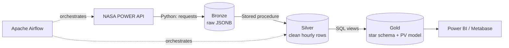

# ☀️ Egypt Solar Data Pipeline

An end-to-end **ELT data pipeline** that collects hourly satellite solar and weather data for Egyptian cities from the **NASA POWER API**, stores it in a **PostgreSQL data warehouse** built on the **Medallion Architecture (Bronze → Silver → Gold)**, and estimates **solar PV energy output** for each city. The pipeline is orchestrated with **Apache Airflow** and runs fully in **Docker**.

> **Question this project answers:** *Where and when in Egypt does solar power produce the most energy?*

---

## 📌 Project Overview

| | |
|---|---|
| **Data source** | [NASA POWER](https://power.larc.nasa.gov/) Hourly API (satellite-derived solar irradiance, temperature, wind) |
| **Cities** | Aswan (Benban solar park), Cairo, Alexandria, Hurghada |
| **Coverage** | January 2025 – October 2026, hourly (≈ 64,000 rows) |
| **Pattern** | ELT: raw API responses loaded first, transformed inside PostgreSQL |
| **Stack** | Python · PostgreSQL · SQL / PL/pgSQL · Apache Airflow · Docker Compose |

---

## 🏗️ Architecture



| Layer | Object | Description | Load method |
|---|---|---|---|
| **Bronze** | `bronze.nasa_power` | One row per API call (city × month); full raw JSON response stored as `JSONB`, plus city, coordinates, date range and fetch time | Incremental append (`ON CONFLICT DO NOTHING`) |
| **Silver** | `silver.nasa_power` | JSON unpacked into one row per city per hour; keys converted to UTC timestamps; values cast to numeric | Full load (truncate & insert) via `silver.load_silver()` |
| **Silver** | `silver.city_location` | One row per city: coordinates and elevation, with a permanent surrogate key | Upsert (SCD Type 1) |
| **Gold** | `gold.dim_city` | City dimension with business-friendly names | View |
| **Gold** | `gold.fact_solar_hourly` | Hourly measurements, local Egypt time, and the PV output model | View |

---

## ⚙️ Pipeline (Airflow DAG)

DAG `ingest_nasa_power`, scheduled **monthly** with **catchup** enabled:

```
create_tables  →  store_solar  →  load_silver
```

1. **`create_tables`**: runs the DDL scripts (bronze/silver tables, silver procedure, gold views). Safe to re-run: `CREATE TABLE IF NOT EXISTS`, `CREATE OR REPLACE PROCEDURE`, views dropped and recreated.
2. **`store_solar`**: calls the NASA POWER API for each city for the run's month (taken from Airflow's `data_interval_start` / `data_interval_end`) and inserts the raw response into bronze. Each city is committed separately, so one failed city doesn't affect the others.
3. **`load_silver`**: `CALL silver.load_silver();` rebuilds silver from bronze.

Gold needs no load task: its views always reflect the latest silver data.

With `catchup=True`, enabling the DAG automatically **backfills** every month since the start date, one month at a time (`max_active_runs=1`).

---

## 🔆 PV Output Model (Gold Layer)

The gold layer estimates the energy a **1 kWp** solar system would produce each hour:

1. **Panel (cell) temperature**, using the NOCT model (NOCT = 45 °C):

   `cell_temperature_c = temperature_c + 0.03125 × irradiance_wm2`

2. **Energy per kWp installed (specific yield):**

   `pv_kwh_per_kwp = (irradiance_wm2 / 1000) × (1 − 0.004 × (cell_temperature_c − 25)) × 0.86`

| Term | Meaning |
|---|---|
| `irradiance / 1000` | Fraction of the 1000 W/m² standard test condition at which panels are rated |
| `−0.004 per °C` | Typical crystalline-silicon power loss per °C above 25 °C |
| `0.86` | Performance ratio (inverter, wiring, soiling and other system losses) |

**Assumptions:** horizontal panels (no tilt optimisation), typical silicon panel coefficients, and NASA grid-cell averages (≈ 1° × 1° for solar data) rather than exact site measurements. The model lives in gold, not silver, because it applies business assumptions on top of cleaned source data.

---

## ✅ Data Quality Checks

SQL quality checks are provided for each layer, including:

- **Completeness:** 24 hours per city per day; expected hours per monthly request.
- **Physical plausibility:** irradiance between 0 and 1,400 W/m²; temperature between −5 and 55 °C; wind speed between 0 and 40 m/s.
- **Night-time check:** irradiance must be 0 at night, which validates the UTC timestamp conversion.
- **Missing values:** NASA's fill value (−999).
- **Keys and relationships:** unique primary and surrogate keys; every fact row joins to a city in `dim_city`.
- **Model sanity:** PV output between 0 and 1 kWh/kWp per hour; cell temperature never below air temperature.

---

## 🚀 How to Run

**Prerequisites:** [Docker Desktop](https://www.docker.com/products/docker-desktop/) (on Windows, with the WSL 2 backend).

1. **Clone the repository**
   ```bash
   git clone https://github.com/ribbonhearted/egypt-solar-data-pipeline.git
   cd egypt-solar-data-pipeline
   ```

2. **Create your `.env` file** from the template and fill in your own values:
   ```bash
   cp .env.example .env
   ```
   Use passwords without special characters (`@ : / # ?`), because they are embedded in a connection URI.

3. **Start the services**
   ```bash
   docker compose up -d
   ```
   On first start, PostgreSQL runs `postgres/init_database.sql` to create the `solar_dw` warehouse database and the `bronze`, `silver` and `gold` schemas.

4. **Open the tools**

   | Service | URL / address |
   |---|---|
   | Airflow | http://localhost:8080 (user from `.env`) |
   | pgAdmin | http://localhost:5051 (connect to host `postgres`, port `5432`) |
   | Metabase | http://localhost:3000 |
   | PostgreSQL (from your machine) | `localhost:5433` |

5. **Run the pipeline:** in Airflow, switch the `ingest_nasa_power` DAG **on**. It backfills all months since the start date automatically.

---

## 📂 Repository Structure

```
egypt-solar-data-pipeline/
├── dags/
│   ├── ingest_nasa_power.py   # Airflow DAG: create tables → ingest → load silver
│   └── config.py              # Cities and their coordinates
├── postgres/
│   ├── init_database.sql      # Creates solar_dw + bronze/silver/gold schemas (first start only)
│   ├── bronze/                # Bronze table DDL
│   ├── silver/                # Silver DDL and load procedure
│   ├── gold/                  # Gold views (star schema + PV model)
│   └── tests/                 # Data quality checks (silver, gold)
├── docker-compose.yml         # PostgreSQL, Airflow, pgAdmin, Metabase
├── .env.example               # Environment variable template
└── README.md
```

---

## 📊 Sample Output

Estimated output of a 1 kWp horizontal solar system in 2025 (from `gold.fact_solar_hourly`):

| City | Total 2025 (kWh/kWp) | Average per day (kWh/kWp) |
|---|---|---|
| Aswan | 1,799 | 4.93 |
| Hurghada | 1,776 | 4.87 |
| Cairo | 1,617 | 4.43 |
| Alexandria | 1,585 | 4.34 |

**Insight:** the same solar system produces about **13% more energy in Aswan than in Alexandria**, reflecting stronger, more consistent sunshine in Upper Egypt despite higher temperatures there.

---

## 🛣️ Future Improvements

- Run the quality checks as a final Airflow task, so bad or incomplete months fail the run automatically.
- Convert NASA's missing-value marker (−999) to `NULL` in silver.
- Add more cities across Egypt (e.g. Kharga, Siwa, Luxor, Zafarana).
- More realistic PV modelling with panel tilt and sun position (e.g. `pvlib`).
- An analytics project with a Power BI dashboard built on the gold layer.

---

## 🙏 Acknowledgements

- Data: These data were obtained from the NASA Langley Research Center (LaRC) POWER Project funded through the NASA Earth Science/Applied Science Program.
- Warehouse methodology (Medallion Architecture, naming and quality-check conventions) inspired by [Data With Baraa](https://www.youtube.com/@DataWithBaraa)'s *SQL Data Warehouse* project.

---

## 👩‍💻 About Me

**Nouran Abobakr**: Electrical Engineering graduate (Menoufia University, 2026) working in data engineering and automation. This project combines both fields: satellite energy data, engineered into a warehouse, and turned into an electrical-engineering estimate of solar output.

[GitHub](https://github.com/ribbonhearted)
